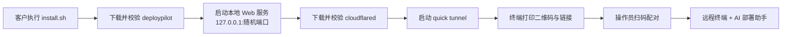

# DeployPilot 远程部署助手

## 简介

DeployPilot 是一个运行在客户 Linux 机器上的单文件客户端。客户执行一行命令后，程序通过 Cloudflare 快速隧道暴露一个本地 Web 控制台，操作员扫码即可获得：

- 远程终端（xterm.js）
- AI 部署助手（白鹿大模型，OpenAI 兼容接口），可自动执行命令、读写文件完成部署

> ⚠️ **警告**：DeployPilot 会把客户机器的完整控制权交给操作员和 AI。只能在客户明确同意的前提下运行。终端与 AI 均以启动程序的用户身份执行，用 root 启动即拥有 root 权限。

## 工作流程



1. 显示 ASCII 欢迎横幅。
2. 在 `127.0.0.1` 的随机端口启动 Web 服务。
3. 下载固定版本 cloudflared `2026.10.5` 到 `~/.deploypilot/bin`，用内置 sha256 校验；依次尝试 `github.com`、`gh-proxy.com`、`ghfast.top`。
4. 启动 quick tunnel，打印二维码和链接 `https://xxx.trycloudflare.com/#t=<token>`。
5. 按 Ctrl+C 结束会话并关闭隧道。

## 快速开始

### 客户侧

支持 Linux amd64 / arm64：

```sh
curl -fsSL https://github.com/66kris-ye/deploypilot/releases/latest/download/install.sh | sh
```

脚本会识别架构，从 GitHub Releases（`66kris-ye/deploypilot`）下载 `deploypilot-linux-<arch>` 和 `checksums.txt`，校验 sha256 后直接运行。

国内网络可加镜像前缀：

```sh
curl -fsSL https://gh-proxy.com/https://github.com/66kris-ye/deploypilot/releases/latest/download/install.sh | DP_MIRROR=https://gh-proxy.com/ sh
```

运行后把终端里的二维码或链接发给操作员。

#### 客户是 Windows

在 PowerShell 里执行：

```powershell
irm https://github.com/66kris-ye/deploypilot/releases/latest/download/install.ps1 | iex
```

国内网络较慢时：

```powershell
$env:DP_MIRROR='https://gh-proxy.com/'; irm https://gh-proxy.com/https://github.com/66kris-ye/deploypilot/releases/latest/download/install.ps1 | iex
```

Windows 下控制的是这台 Windows 机器本身，网页终端用的是 PowerShell（通过 ConPTY）。目前提供 amd64 版，arm64 机器会以模拟方式运行 amd64 版。

### 操作员侧

1. 扫码或打开链接，自动完成配对。
2. 桌面左侧为远程终端，右侧为部署任务；手机通过顶部页签切换。
3. 在「模型设置」中填写 API Key（如 `sk-xxxx`）和模型，点「获取列表」可查询可用模型。设置只保存在内存中。
4. 用自然语言描述部署任务，AI 会全自动执行，可用工具：`run_command`、`read_file`、`write_file`、`edit_file`、`append_file`、`finish`。单次任务最多 30 步；工具串行执行，每条命令默认超时 600 秒，最长 3600 秒。

### 工作台操作

- 桌面默认左侧终端约占 60%，可拖动分隔线或聚焦后用方向键调整；手机通过顶部页签切换。调整布局与切换外观不会重建终端连接或重启 AI 任务。
- 左侧终端与 Agent 共用同一个持续运行的 Shell。切换目录和环境变量对后续命令与人工操作都生效；Agent 运行及清理期间暂停人工输入，结束后在原终端接续操作。任务面板显示命令退出码，终端展示实际输出。
- 选中终端文字后按 `Ctrl+C`、`Ctrl+Shift+C` 或 macOS 的 `⌘+C` 复制，Agent 运行期间也可复制。无选中文字时，`Ctrl+C` 保留终端中断行为；Agent 只读期间不会发送中断。
- 顶栏右侧的外观设置提供日间、夜间和护眼模式，首次默认夜间；手动选择保存在当前浏览器地址下。护眼为暖色外观，不代表健康效果。点击项目旁的设备名称可查看系统、运行用户和启动目录。
- 点击示例填入任务，或自行输入；`Enter` 执行，`Shift+Enter` 换行，中文输入法选词不会发送。运行时可以准备下一条任务，但清理完成前无法提交；这不会修改当前任务，下一条任务仍独立执行。
- 任务显示连接中、执行中、停止中和已结束。点击停止后等待清理确认，才可启动下一次任务；单次工具错误会展示在记录中，不代表任务已经结束。
- 运行记录保留公开的助手进展说明，显示收集环境、等待模型和执行工具的真实活动。命令详情显示设备、启动目录、退出码与耗时；执行中和出错默认展开，完成默认收起。上翻日志时暂停自动跟随，点击“返回最新记录”继续跟随。浏览器保留最近 300 条记录，并限制每条文本长度，截断时会显示提示。
- 点击输入框左下方的模型名称（未配置时显示“配置模型”）打开设置；已有 API Key 时留空保留。输入 API Key 后可直接获取模型列表，密钥会先保存在当前进程内存。任务运行时设置按钮暂不可用，运行任务持有启动时的模型配置。
- 获取模型列表后，展开选择框可查看全部模型，输入文字可搜索；支持滚动、方向键和 Enter 选择，也可手动输入模型名。
- 终端断开后点击“重新连接”即可回到原 Shell 并回放近期输出。AI 连接自动重连并恢复任务状态，刷新页面不会取消任务，也不会重新发送任务。停止任务须使用“停止”；认证过期、主动撤销授权或程序退出仍会取消任务。
- 任务记录保存在本机 `~/.deploypilot/history/<工作目录标识>/`，历史选择只加载记录。记录逐任务保存，不因新建任务删除旧会话；每个任务保留最近 512 条事件和最多约 512 KiB 的过程内容，终端保留最近 2 MiB 输出。首次升级会从最近 100 份旧版执行日志恢复已记录事实，不改动原文件。
- 同一客户端只允许一个 AI 任务，跨标签页和重连也受限制；旧任务清理完成后才允许再次执行。Windows 命令取消或超时会终止其关联子进程，正常完成时刻意启动的后台服务可以继续运行。
- 长任务会自动压缩上下文：先截短较早的工具输出，保留首尾，再把完整执行轮次整理为历史摘要；始终保留系统约束和原始任务。压缩会显示提示，不额外调用模型。较早细节可能被省略，需要时应重新读取文件或检查机器。
- 工具参数缺失、类型错误、空命令/路径等会被拒绝并显示错误；模型流中断、输出长度截断或调用数据不完整时，不执行该响应的工具，也不报告任务成功。

## 配置

| 变量 | 作用 | 默认值 |
| --- | --- | --- |
| `DP_VERSION` | install.sh 安装的版本标签 | `latest` |
| `DP_BASE_URL` | 发布文件的完整基础 URL | GitHub Releases |
| `DP_MIRROR` | 加在 GitHub URL 前的镜像前缀，如 `https://gh-proxy.com/` | 空 |
| `DP_INSTALL_DIR` | 二进制安装目录 | 临时目录（运行一次） |
| `DP_CLOUDFLARED_MIRROR` | cloudflared 下载源，逗号分隔，每项作为 GitHub 路径前缀，如 `https://gh-proxy.com/https://github.com` | 内置列表 |
| `DP_CLOUDFLARED_BIN` | 使用已有的 cloudflared，跳过下载 | 空 |
| `BAILU_API_KEY` | 白鹿 API Key（如 `sk-xxxx`） | 空 |
| `BAILU_MODEL` | 模型名 | `bailu-auto`（已验证支持流式输出和工具调用） |
| `BAILU_BASE_URL` | OpenAI 兼容接口地址 | `https://bailucode.com/openapi/v1` |
| `DP_CONTEXT_BYTES` | 每次模型请求 JSON 的字节预算，含消息和工具定义；允许 16384–2097152 | `131072`（128 KiB） |
| `NO_COLOR` | 关闭横幅颜色 | 空 |

## 隧道恢复

- 启动最多等待 120 秒；取得临时网址且 cloudflared 确认首次边缘连接后显示二维码，公共 DNS/路由可能还需要短暂传播时间。
- 短暂网络中断由 cloudflared 自行重连。进程退出或启动失败时，客户端按 1、2、4、8 秒退避；连续 5 次失败后退出并显示原因，运行超过 1 分钟重置该计数。
- 进程重建后会换网址，旧会话和旧配对链接立即失效；请使用终端里的新二维码重新配对。中断任务不会自动重放；历史记录、近期终端输出和最后工作目录会恢复。程序重启会新建 Shell，旧进程、临时变量及环境修改不能恢复。
- WebSocket 每 25 秒发送 ping；75 秒没有 pong 回复就关闭失联连接并进入既有任务清理流程。心跳不延长认证有效期。
- cloudflared 下载从请求开始每 10 秒检查进度；响应头卡住或窗口内不足 512 KiB 时切换下一源，每源最长 5 分钟。下载文件独立隔离，校验成功后才替换缓存。

## 安全说明

- **配对令牌**：32 字节随机数，放在 URL fragment（`#t=`）中，不会发送到服务端或出现在 Cloudflare 日志里；一次性使用，10 分钟过期。
- **会话**：同一时间只允许一个会话；Cookie 为 `HttpOnly` + `Secure` + `SameSite=Strict` 的浏览器会话 Cookie。服务端统一判断空闲 30 分钟失效，包括已建立的 WebSocket；实际输入和任务输出续期，自动 ping/pong 不续期。
- **WebSocket** 校验 Origin。
- **退出**：Ctrl+C 吊销会话、关闭服务和隧道。
- **API Key** 只保存在内存中，错误信息里会脱敏。
- **审计日志**：`~/.deploypilot/audit-<时间>.jsonl`。
- **命令黑名单**：拦截 `rm -rf /`、`mkfs`、`dd` 写块设备、`wipefs`、`shred /dev/*`、fork bomb、`shutdown`/`reboot`/`poweroff`、`chmod -R 777 /`、`chown -R ... /` 等。黑名单只是兜底，不是沙箱。
- 再次提醒：只在客户同意时运行，权限等同于启动它的用户。

## 开发与构建

### Windows

Go 优先使用 `.tools\go`，找不到时用系统 `go`（也可通过 `GO` 环境变量指定）。

```powershell
npm --prefix web install
npm --prefix web run build
npm --prefix web test      # Node.js 22.18+：任务状态与日志边界测试
npm --prefix web run test:browser  # 需要已安装 Chrome；使用模拟 API/WS，不调用真实模型
client\build.ps1          # 交叉编译 linux amd64/arm64 到 dist\，并生成 checksums.txt
client\build.ps1 -Local   # 编译本机二进制
client\build.ps1 -Test    # 运行 go test ./...
```

### Linux / CI

```sh
make build
make test
make lint
make e2e-docker
```

### 联调白鹿接口

```powershell
# 先把 API Key 复制到剪贴板
powershell -ExecutionPolicy Bypass -File scripts\live-test.ps1 -FromClipboard              # 自动选第一个模型
powershell -ExecutionPolicy Bypass -File scripts\live-test.ps1 -FromClipboard -Model <名>
```

不加 `-FromClipboard` 时脚本会弹出隐藏输入框，那里不能用 Ctrl+V，要用鼠标右键粘贴。脚本读取的 API Key只在本次进程内有效，不写入磁盘和命令历史。它会依次测试模型列表、流式对话、工具调用，最后用模拟服务器跑一遍完整的 agent 多步流程。Linux / CI 上可以执行 `BAILU_API_KEY=... go test -run Live -v ./internal/llm/ ./internal/agent/`。

### 发布

推送 `v*` 标签后由 GitHub Actions 构建并发布 Release。

## 目录结构

```
client/
  cmd/deploypilot/     程序入口
  internal/
    banner/            ASCII 横幅
    server/            本地 HTTP / WebSocket 服务
    auth/              配对令牌与会话
    tunnel/            cloudflared 下载、隧道、二维码
    pty/               伪终端
    llm/               OpenAI 兼容客户端
    agent/             AI 代理、工具、命令黑名单
    webui/             内嵌前端资源
web/src/               前端源码（xterm.js 控制台）
scripts/install.sh     客户侧安装脚本
```

## 已知限制

- Agent 的命令结果保留最多 16 KiB 的开头和末尾，并明确标注中间截断；上下文回收优先处理旧历史，尽量保留最近完整工具轮次。工具失败会返回错误及结束状态；普通文字回复不会自动算成功，最多提醒一次显式调用 `finish`。`finish` 仍是模型结论，不代替独立部署验收。
- 上下文预算按请求 JSON 的字节计算，不是精确 token 数，也不能自动识别供应商的模型窗口。使用较小窗口的模型时应降低 `DP_CONTEXT_BYTES` 并给回复留出空间；原始任务本身超过预算会明确报错，不会静默删除目标。
- trycloudflare 快速隧道适合临时接入，官方不提供在线时间保证，重建会改变网址；固定域名和生产接入应使用正式 Cloudflare Tunnel。不同地区和运营商的实际可达性需要实测。
- 支持 Linux amd64 / arm64 和 Windows amd64。Windows 上的 AI 助手通过 PowerShell 执行命令，但内置的部署知识（apt、vLLM 等）面向 Linux，Windows 下的自动部署能力有限。
- 命令黑名单只是安全兜底，不能替代沙箱或权限隔离。
