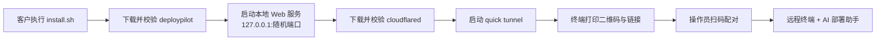

# DeployPilot 远程部署助手

## 简介

DeployPilot 是一个运行在客户 Linux 机器上的单文件客户端。客户执行一行命令后，程序通过 Cloudflare 快速隧道暴露一个本地 Web 控制台，操作员扫码即可获得：

- 远程终端（xterm.js）
- AI 部署助手（白鹿大模型，OpenAI 兼容接口），可自动执行命令、读写文件完成部署

> ⚠️ **警告**：DeployPilot 会把客户机器的完整控制权交给操作员和 AI。只能在客户明确同意的前提下运行。终端与 AI 均以启动程序的用户身份执行，用 root 启动即拥有 root 权限。

## 工作流程



1. 显示 ASCII 欢迎横幅。
2. 在 `127.0.0.1` 的随机端口启动 Web 服务。
3. 下载固定版本 cloudflared `2026.10.5` 到 `~/.deploypilot/bin`，用内置 sha256 校验；依次尝试 `github.com`、`gh-proxy.com`、`ghfast.top`。
4. 启动 quick tunnel，打印二维码和链接 `https://xxx.trycloudflare.com/#t=<token>`。
5. 按 Ctrl+C 结束会话并关闭隧道。

## 快速开始

### 客户侧

支持 Linux amd64 / arm64：

```sh
curl -fsSL https://github.com/66kris-ye/deploypilot/releases/latest/download/install.sh | sh
```

脚本会识别架构，从 GitHub Releases（`66kris-ye/deploypilot`）下载 `deploypilot-linux-<arch>` 和 `checksums.txt`，校验 sha256 后直接运行。

国内网络可加镜像前缀：

```sh
curl -fsSL https://gh-proxy.com/https://github.com/66kris-ye/deploypilot/releases/latest/download/install.sh | DP_MIRROR=https://gh-proxy.com/ sh
```

运行后把终端里的二维码或链接发给操作员。

#### 客户是 Windows

在 PowerShell 里执行：

```powershell
irm https://github.com/66kris-ye/deploypilot/releases/latest/download/install.ps1 | iex
```

国内网络较慢时：

```powershell
$env:DP_MIRROR='https://gh-proxy.com/'; irm https://gh-proxy.com/https://github.com/66kris-ye/deploypilot/releases/latest/download/install.ps1 | iex
```

Windows 下控制的是这台 Windows 机器本身，网页终端用的是 PowerShell（通过 ConPTY）。目前提供 amd64 版，arm64 机器会以模拟方式运行 amd64 版。

### 操作员侧

1. 扫码或打开链接，自动完成配对。
2. 左侧是远程终端，右侧是「AI 部署助手」面板。
3. 在设置中填写 API Key（如 `sk-xxxx`）和模型，点「拉取列表」可调用 `GET /models` 获取可用模型。设置只保存在内存中。
4. 用自然语言描述部署任务，AI 会全自动执行，可用工具：`run_command`、`read_file`、`write_file`、`finish`。单次任务最多 30 步，每条命令有超时（默认 600 秒）。

## 配置

| 变量 | 作用 | 默认值 |
| --- | --- | --- |
| `DP_VERSION` | install.sh 安装的版本标签 | `latest` |
| `DP_BASE_URL` | 发布文件的完整基础 URL | GitHub Releases |
| `DP_MIRROR` | 加在 GitHub URL 前的镜像前缀，如 `https://gh-proxy.com/` | 空 |
| `DP_INSTALL_DIR` | 二进制安装目录 | 临时目录（运行一次） |
| `DP_CLOUDFLARED_MIRROR` | cloudflared 下载源，逗号分隔，每项作为 GitHub 路径前缀，如 `https://gh-proxy.com/https://github.com` | 内置列表 |
| `DP_CLOUDFLARED_BIN` | 使用已有的 cloudflared，跳过下载 | 空 |
| `BAILU_API_KEY` | 白鹿 API Key（如 `sk-xxxx`） | 空 |
| `BAILU_MODEL` | 模型名 | `bailu-auto`（已验证支持流式输出和工具调用） |
| `BAILU_BASE_URL` | OpenAI 兼容接口地址 | `https://bailucode.com/openapi/v1` |
| `NO_COLOR` | 关闭横幅颜色 | 空 |

## 安全说明

- **配对令牌**：32 字节随机数，放在 URL fragment（`#t=`）中，不会发送到服务端或出现在 Cloudflare 日志里；一次性使用，10 分钟过期。
- **会话**：同一时间只允许一个会话；Cookie 为 `HttpOnly` + `Secure` + `SameSite=Strict`；空闲 30 分钟自动失效。
- **WebSocket** 校验 Origin。
- **退出**：Ctrl+C 吊销会话、关闭服务和隧道。
- **API Key** 只保存在内存中，错误信息里会脱敏。
- **审计日志**：`~/.deploypilot/audit-<时间>.jsonl`。
- **命令黑名单**：拦截 `rm -rf /`、`mkfs`、`dd` 写块设备、`wipefs`、`shred /dev/*`、fork bomb、`shutdown`/`reboot`/`poweroff`、`chmod -R 777 /`、`chown -R ... /` 等。黑名单只是兜底，不是沙箱。
- 再次提醒：只在客户同意时运行，权限等同于启动它的用户。

## 开发与构建

### Windows

Go 优先使用 `.tools\go`，找不到时用系统 `go`（也可通过 `GO` 环境变量指定）。

```powershell
npm --prefix web install
npm --prefix web run build
client\build.ps1          # 交叉编译 linux amd64/arm64 到 dist\，并生成 checksums.txt
client\build.ps1 -Local   # 编译本机二进制
client\build.ps1 -Test    # 运行 go test ./...
```

### Linux / CI

```sh
make build
make test
make lint
make e2e-docker
```

### 联调白鹿接口

```powershell
# 先把 API Key 复制到剪贴板
powershell -ExecutionPolicy Bypass -File scripts\live-test.ps1 -FromClipboard              # 自动选第一个模型
powershell -ExecutionPolicy Bypass -File scripts\live-test.ps1 -FromClipboard -Model <名>
```

不加 `-FromClipboard` 时脚本会弹出隐藏输入框，那里不能用 Ctrl+V，要用鼠标右键粘贴。脚本读取的 API Key只在本次进程内有效，不写入磁盘和命令历史。它会依次测试模型列表、流式对话、工具调用，最后用模拟服务器跑一遍完整的 agent 多步流程。Linux / CI 上可以执行 `BAILU_API_KEY=... go test -run Live -v ./internal/llm/ ./internal/agent/`。

### 发布

推送 `v*` 标签后由 GitHub Actions 构建并发布 Release。

## 目录结构

```
client/
  cmd/deploypilot/     程序入口
  internal/
    banner/            ASCII 横幅
    server/            本地 HTTP / WebSocket 服务
    auth/              配对令牌与会话
    tunnel/            cloudflared 下载、隧道、二维码
    pty/               伪终端
    llm/               OpenAI 兼容客户端
    agent/             AI 代理、工具、命令黑名单
    webui/             内嵌前端资源
web/src/               前端源码（xterm.js 控制台）
scripts/install.sh     客户侧安装脚本
```

## 已知限制

- trycloudflare 快速隧道在中国大陆可能较慢或不稳定，后续可改用自有域名的 named tunnel。
- 支持 Linux amd64 / arm64 和 Windows amd64。Windows 上的 AI 助手通过 PowerShell 执行命令，但内置的部署知识（apt、vLLM 等）面向 Linux，Windows 下的自动部署能力有限。
- 命令黑名单只是安全兜底，不能替代沙箱或权限隔离。
