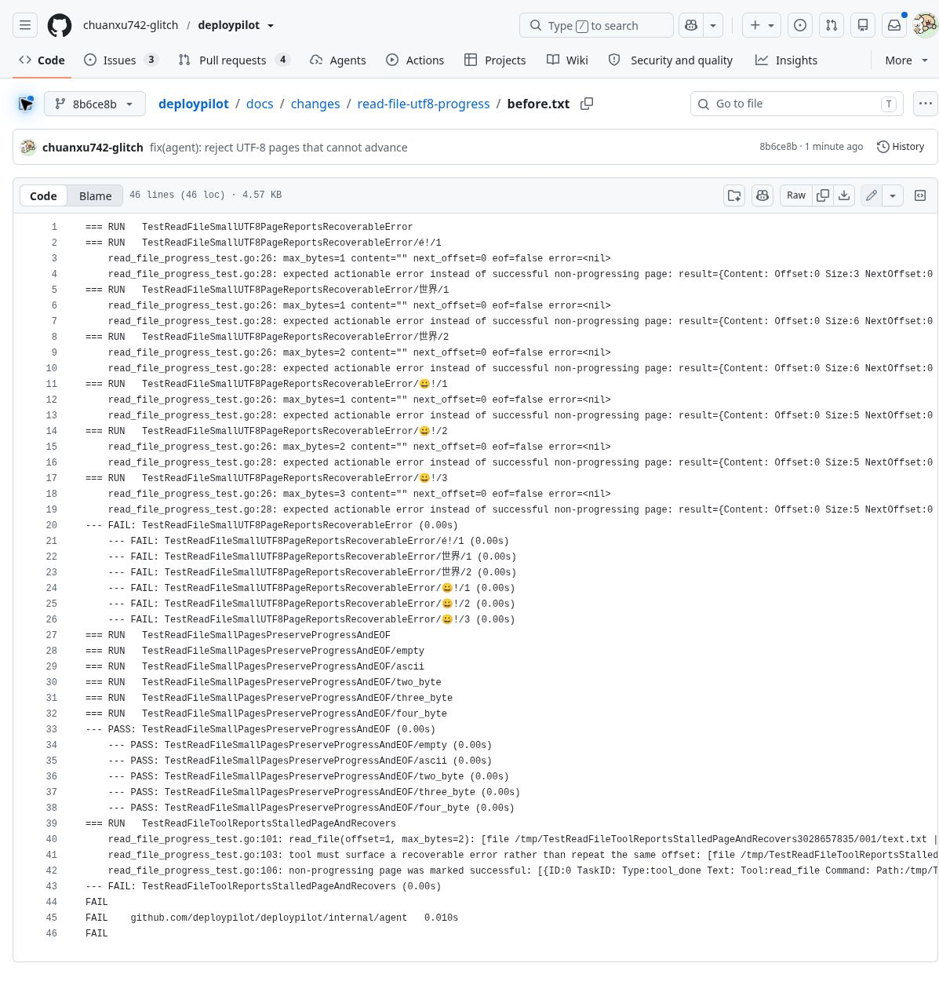
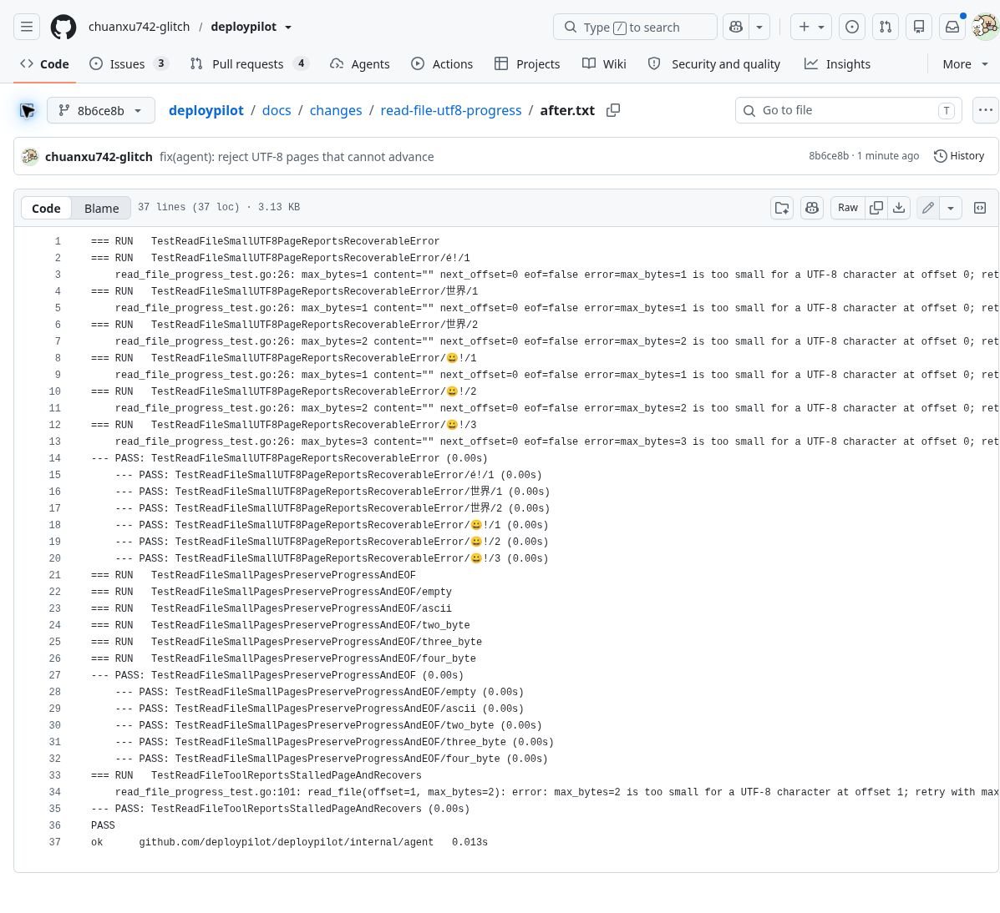

# read_file：避免 UTF-8 小分页返回成功但不前进

## 影响范围

基线：`main` 的 `9d5114c14a988966f9c68865c91338a42962f8bf`。

合法的 `max_bytes=1`、`2` 或 `3` 小于当前 UTF-8 字符的字节数时，原代码裁掉了该不完整字符，却仍然报告读取成功，返回空内容、`EOF=false` 和未变化的 `NextOffset`。工具回复甚至建议继续使用同一 offset。如果调用者按这个提示用相同页大小续读，就会反复得到同一空页。

例：文件内容为 `a世界`。先以 `offset=0,max_bytes=2` 读取，得到 `a` 和 `next_offset=1`；接着以 `offset=1,max_bytes=2` 读取，原版返回 `shown 1-1`、`more remains; read next with offset=1`，并发出 `Success=true`。

这是小分页参数的功能边界缺陷，不是默认 16 KiB 分页失效，也不是 FIFO 阻塞或越权漏洞。已核对 #2、#4、#5、#6、#7，没有复用这些已有事项的根因。

## 修复

若裁掉不完整字符后整页没有内容，返回明确错误，提示在同一 offset 使用 `max_bytes >= 4` 重试。遵守调用者给出的字节上限，不返回半个字符，不跳过字符。保留 ASCII 的 1 字节分页、恰好容纳一个字符的分页、空文件和 EOF 行为；工具说明同步记录这个边界。

## 独立复现原版

从本分支检出后，在仓库根目录执行以下命令。需要 Go 1.27.x；这里只运行本地文件和工具分发测试，不运行主程序、不连接隧道、不调用模型。

```sh
baseline=$(mktemp -d)
git archive 9d5114c14a988966f9c68865c91338a42962f8bf client | tar -x -C "$baseline"
cp client/internal/agent/read_file_progress_test.go "$baseline/client/internal/agent/"
(cd "$baseline/client" && go test ./internal/agent -run 'TestReadFile(Small|ToolReports)' -count=1 -v)
```

预期原版失败：2、3、4 字节 UTF-8 字符的六种不足页大小全部返回空的成功结果，实际 `runTool` 也将无进展页标成成功。

原始完整输出：[before.txt](before.txt)。该输出为真实测试结果，未使用替身文件读取器。

截图是浏览器中显示的上述原始测试日志，不是部署现场或应用界面。长行可能超出截图右侧，完整内容见文本文件。



## 验证修复

```sh
cd client
go test ./internal/agent -run 'TestReadFile(Small|ToolReports)' -count=1 -v
go test ./internal/agent -run TestReadFile -race -count=5
```

- 修复后的完整输出：[after.txt](after.txt)。同一 offset 增大页大小后，准确读取剩余字符。
- 覆盖 2/3/4 字节字符、ASCII/空文件、恰好容纳字符的页、非零 offset、工具失败事件和恢复后的成功事件。
- Linux amd64 / Go 1.27.3：`go vet ./...`、`go test ./... -count=1`、上述 `-race -count=5` 全通过。
- 前端构建和 33 项单元测试通过。全包 Go 检查需要先 `npm --prefix web ci && npm --prefix web run build` 生成嵌入资源；第一次未构建资源的检查因此未通过，完成构建后重新运行通过。
- Windows amd64、Linux arm64 的 `go build ./...` 交叉构建通过；未在 Windows 或 arm64 实机运行。
- 汇总命令输出：[verification.txt](verification.txt)。未运行 Docker E2E、现场部署或付费模型联调。



提交前再次获取 main，仍为上述基线。与 #5 修改同一文件的不同部分，后续整合应重跑 `TestReadFile`。不合并、不部署、不自动关闭已有事项。
