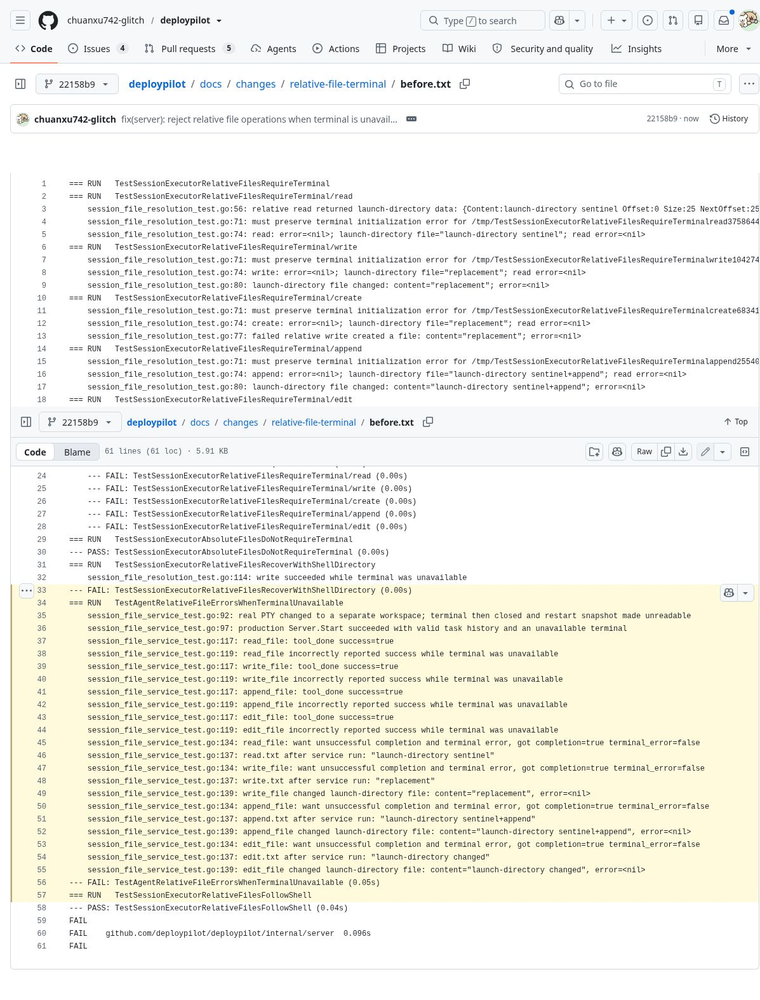
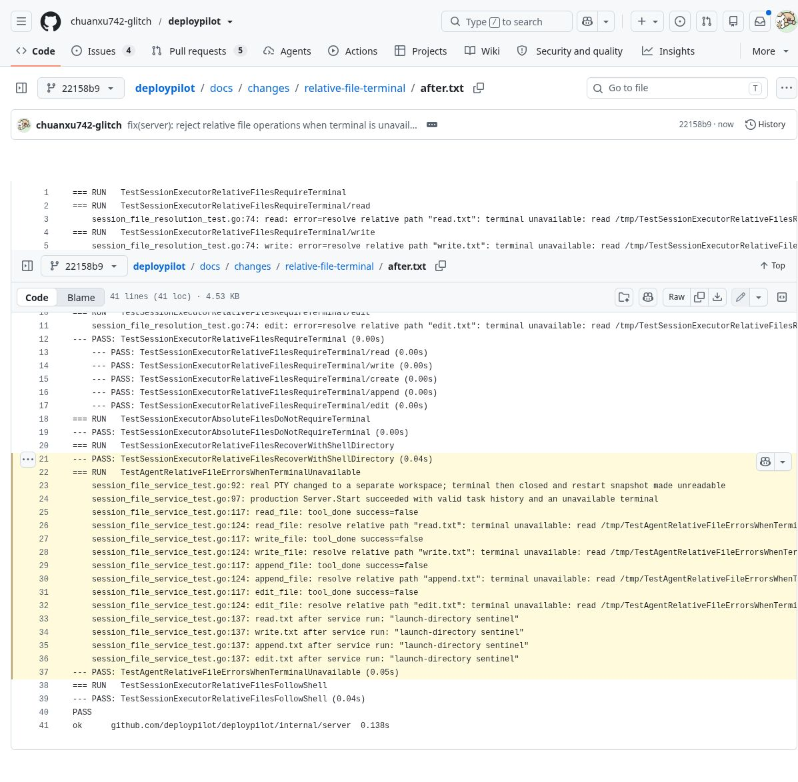

# 共享终端不可用时，相对文件路径不能回退到进程目录

## 已确认的问题

验证基线：`main` 提交 `9d5114c14a988966f9c68865c91338a42962f8bf`。

`sessionExecutor.WorkingDirectory()` 把共享终端初始化错误转换成空字符串。原 `path()` 随后执行 `filepath.Join("", path)`，仍得到相对路径。生产文件执行器按 DeployPilot 进程的当前目录处理该路径，而不是拒绝无法确定共享 Shell 工作目录的操作。

结果是 `read_file` 可以读取启动目录内的文件，`write_file`、`append_file`、`edit_file` 可以创建或修改该目录内的文件，并报告成功。这里只验证了已认证操作者/Agent 的文件操作；不声称存在绕过认证、跨权限访问或默认正常会话也会出错。

## 真实复现范围

Go 1.27.3 / Linux amd64，临时目录和文件，本地确定性模型替身，无付费模型调用、客户数据或真实部署。

1. 使用生产 `New(Options)` 和默认 `newExecutor`，不是手工拼接不完整的 Server。
2. 将历史目录内的 `terminal.json` 建成目录。任务历史仍正常可用，但 `newSharedShell` 读取终端快照时报 `is a directory`。
3. 文件层分别调用相对路径 read、write、create、append、edit。原版五项全部失败：没有返回初始化错误，并实际读取或修改了进程目录中的哨兵文件。
4. 服务层先启动真实 PTY 并切换到与进程目录不同的工作区，关闭终端后将其 `terminal.json` 改成目录以阻止重启。随后调用真实 `Server.Start()`，确认 HTTP 启动成功；通过已配对的 WebSocket 请求执行四种文件工具。本地模型替身只提供固定工具调用，执行器和文件 I/O 都是生产实现。
5. 原版四种工具均发出 `tool_done success=true`，write/append/edit 的磁盘结果确实改变。
6. 修复后四种工具均发出 `success=false` 和包含原始终端错误的信息；所有哨兵文件保持不变。拒绝的新建文件不存在。
7. 绝对路径操作在同样终端故障下仍可读写。移除故障后启动真实 PTY，切换 Shell 目录，四种相对文件操作恢复并落到正确目录。

最初的候选复现用 HistoryDir 指向普通文件；该条件会被正常 `Server.Start()` 拒绝，所以最终回归改用上述可正常启动 HTTP 的终端快照故障。没有把测试构造/清理问题当成应用缺陷。

## 修复

- `path()` 返回 `(string, error)`，相对路径直接请求共享终端，并向上传递初始化错误，保留底层 `*os.PathError`。
- 无有效绝对 Shell 工作目录时也拒绝相对路径。
- read/write/append/edit 在解析失败时返回错误，不调用底层文件执行器。
- 不改变绝对路径、正常 Shell 工作目录、文件内容处理或授权边界。
- `WorkingDirectory() string` 保持作为尽力获取的事件元数据接口，文件 I/O 不再依赖它的空字符串回退。

## 重跑修复后测试

使用 Go 1.27.x 和 Node 22.18+。在本 PR 分支：

```sh
npm --prefix web ci
npm --prefix web run build
npm --prefix web test
cd client
unset BAILU_API_KEY DP_TEST_CLOUDFLARED_LIVE_BIN DP_BROWSER_INTEGRATION
go vet ./...
go test ./... -count=1 -skip '^(TestMachineInfoReportsReadableProbes|TestLive)'
go test ./internal/server -run '^(TestSessionExecutor.*|TestAgentRelativeFileErrorsWhenTerminalUnavailable)$' -count=1 -v
go test -race ./internal/server -run '^(TestSessionExecutor.*|TestAgentRelativeFileErrorsWhenTerminalUnavailable)$' -count=5
CGO_ENABLED=0 GOOS=windows GOARCH=amd64 go build -buildvcs=false ./...
CGO_ENABLED=0 GOOS=linux GOARCH=arm64 go build -buildvcs=false ./...
```

## 在未修复 main 上重跑

以下命令从本 PR 分支的仓库根目录执行。它创建独立 worktree，只把两份回归测试放入原版代码，不修改当前分支：

```sh
git worktree add --detach ../deploypilot-before-relative-files 9d5114c14a988966f9c68865c91338a42962f8bf
for test in session_file_resolution_test.go session_file_service_test.go; do
  git show HEAD:client/internal/server/$test > ../deploypilot-before-relative-files/client/internal/server/$test
done
cd ../deploypilot-before-relative-files
npm --prefix web ci
npm --prefix web run build
cd client
go test ./internal/server -run '^(TestSessionExecutor.*|TestAgentRelativeFileErrorsWhenTerminalUnavailable)$' -count=1 -v
```

预期退出码为 1：相对路径故障回归和服务回归失败，绝对路径控制组以及已有的正常共享目录测试通过。测试只操作自身临时目录，并在结束时清理。

## 验证结果与边界

- [修复前完整输出](before.txt)：五项文件故障用例失败，服务四种工具错误地报告成功。
- [修复后完整输出](after.txt)：新增回归、恢复和绝对路径控制组，以及已有相对目录测试通过。
- [早期构建与验证日志](validation.txt)：前端生产构建、33 项前端单测、`go vet ./...`、`go test ./... -count=1`、当时版本的定向 `-race -count=5` 通过。随后增强服务测试，加入真实 PTY 的不同工作目录。
- [最终本地验证](final-local-checks.txt)：增强后的最终代码通过 `go vet ./...`、各包本地测试及定向 `-race -count=5`。明确跳过已有 `TestMachineInfoReportsReadableProbes` 和 `TestLive*`。前者会通过生产 MachineInfo 发起不带凭据的 `curl https://modelscope.cn` 首页连通性 GET，最后一次全量检查遭测试环境拒绝该外连。没有重试该请求；最终运行显式排除这项网络探测并清空 live-test 开关。该 GET 不是模型推理，但不算本地模拟请求。
- [交叉构建日志](cross-build.txt)：Windows amd64 和 Linux arm64 通过。第一次交叉构建因独立 git archive 没有 `.git`、VCS stamping 失败；显式 `-buildvcs=false` 重跑后通过，没有把第一次失败计作通过。
- 本次前端依赖从本机已有依赖目录复制，复制前确认 lockfile SHA-256 一致，随后重新实际构建前端；没有使用旧生成 dist 作为最终验证。
- 没有在 Windows/arm64 实机运行，没有执行 Docker E2E 或浏览器应用交互回归。截图只展示真实测试日志，不是应用 UI 或生产现场。
- 查阅现有事项和 PR #2/#4/#5/#7/#9，未发现同一修复；#2 也修改 `session_executor.go` 的相邻执行逻辑，但其相对文件路径仍使用旧实现。与其后续整合时需重新运行本回归。
- 本改动基于最新 main 独立提出，不合并、不发布、不部署、不自动关闭 Issue。

## 截图

以下是浏览器实际打开提交 `22158b91bc30a7bed0d1fc9982bc3204c68514ab` 的 GitHub 日志页面后的截图，已目视核对。不是应用 UI、生成图片或部署现场。浏览器宽度使部分长行右端未显示，完整内容见文本日志。





截图 SHA-256：
- before.jpg: `dc0ace6d1b9e325dd4a6e526a0303543d49f38af005d3922558f9a53067c32c9`
- after.jpg: `074215d3d9b0578e53dcc8f98465d86ac1bb2edb845da7477c1a7d0e720b3a21`
